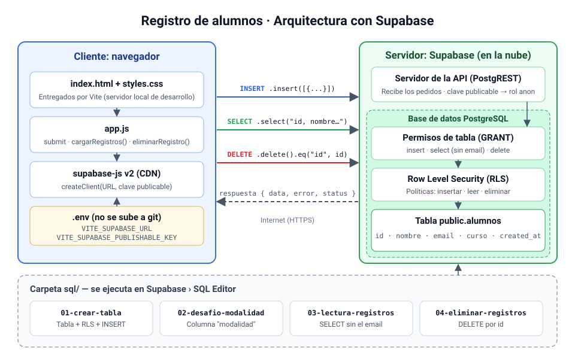

# Registro de alumnos con Supabase

Proyecto de práctica para clase: un formulario web que **guarda, lista y elimina** alumnos en una tabla de [Supabase](https://supabase.com), usando JavaScript sin frameworks, el cliente oficial `supabase-js` y [Vite](https://vitejs.dev) como servidor de desarrollo.

> ⚠️ Es un proyecto **solo para práctica**: usá únicamente datos ficticios. Las políticas de seguridad están abiertas a propósito para aprender (ver [Seguridad](#seguridad)).

## Diagrama del proyecto



El proyecto sigue el modelo **cliente-servidor**:

- **Cliente:** el navegador, que ejecuta `index.html`, `styles.css` y `app.js`. Durante el desarrollo, Vite es un servidor local que solo entrega estos archivos; no guarda datos.
- **Servidor:** **Supabase**, en la nube. No hace falta programar un servidor propio porque Supabase ya trae:
  - un **servidor de API** (PostgREST) que recibe los pedidos HTTPS del navegador;
  - una **base de datos PostgreSQL** que guarda la tabla `alumnos` y aplica los permisos y las políticas de seguridad.

Recorrido de un pedido:

1. La persona completa el formulario en `index.html`.
2. `app.js` lee los valores y, con el cliente de `supabase-js`, envía la petición por internet al servidor de la API de Supabase.
3. El servidor identifica la clave publicable como el rol **`anon`** y la base de datos comprueba los **permisos de tabla (GRANT)** y luego las **políticas RLS**.
4. Si todo está permitido, se ejecuta la operación sobre la tabla `public.alumnos` y se devuelve `{ data, error, status }`.
5. `app.js` muestra un mensaje y vuelve a cargar la lista de registros.

## Tecnologías

| Herramienta | Uso |
|---|---|
| HTML + CSS | Formulario y lista de registros (`index.html`, `styles.css`) |
| JavaScript (módulo ES) | Lógica de la página (`app.js`) |
| `@supabase/supabase-js` v2 (CDN) | Cliente para comunicarse con Supabase |
| Vite | Servidor de desarrollo y lectura de variables del `.env` |
| Supabase / PostgreSQL | Base de datos, API REST y Row Level Security |

## Estructura

```
proyecto-supabase/
├── index.html              # Formulario + sección "Registros guardados"
├── styles.css              # Estilos
├── app.js                  # Versión de clase (pasos 1 a 7)
├── respaldo/
│   └── app.final.js        # Versión completa de respaldo
├── sql/
│   ├── 01-crear-tabla.sql          # Tabla alumnos + RLS + permiso de INSERT
│   ├── 02-desafio-modalidad.sql    # Desafío: columna "modalidad"
│   ├── 03-lectura-registros.sql    # Permiso de SELECT (sin email)
│   └── 04-eliminar-registros.sql   # Permiso de DELETE
├── docs/
│   └── diagrama.svg        # Diagrama del README
├── .env.example            # Plantilla de variables de entorno
└── package.json
```

## Puesta en marcha

### 1. Preparar la base de datos

En el panel de Supabase: **SQL Editor › New query**, pegar y ejecutar (**Run**) los scripts de la carpeta `sql/` en orden:

1. `01-crear-tabla.sql` – crea la tabla `alumnos`, activa RLS y permite insertar.
2. `03-lectura-registros.sql` – permite leer `id`, `nombre`, `curso` y `created_at` (el email **no** se puede leer).
3. `04-eliminar-registros.sql` – permite borrar filas por `id`.
4. *(Opcional)* `02-desafio-modalidad.sql` – solución del desafío.

### 2. Configurar las variables de entorno

Copiá `.env.example` como `.env` y completá con los datos de tu proyecto (Supabase › Project Settings › API):

```env
VITE_SUPABASE_URL=https://TU-PROYECTO.supabase.co
VITE_SUPABASE_PUBLISHABLE_KEY=TU_CLAVE_PUBLICABLE
```

> Usá la clave **publicable** (`sb_publishable_...`), **nunca** la clave secreta. El archivo `.env` está en `.gitignore` y no se sube al repositorio.

### 3. Instalar y ejecutar

```bash
npm install
npm run dev
```

Abrí la dirección que muestra la terminal (por defecto `http://localhost:5173`).

> No abras el proyecto con Live Server: las variables `import.meta.env` solo funcionan a través de Vite.

## Pasos de la clase (`app.js`)

| Paso | Qué se hace | Método de Supabase |
|---|---|---|
| 1 | Crear el cliente con URL + clave publicable | `createClient(url, key)` |
| 2 | Escuchar el `submit` del formulario | — |
| 3 | Leer los valores del formulario | — |
| 4 | Insertar el registro | `.from("alumnos").insert([...])` |
| 5 | Interpretar la respuesta y mostrar un mensaje | `{ data, error, status }` |
| 6 | Listar los últimos 20 registros | `.select(...).order(...).limit(20)` |
| 7 | Eliminar un registro por su id | `.delete({ count: "exact" }).eq("id", id)` |

La versión terminada está en `respaldo/app.final.js`.

## Seguridad

- **RLS activado:** sin políticas, nadie puede leer ni escribir desde el navegador.
- **Permisos por columna:** el rol `anon` no puede leer el `email`.
- **Políticas de práctica:** cualquier persona con la clave publicable puede insertar, leer y borrar filas. En un sistema real hace falta inicio de sesión y políticas que limiten qué filas puede tocar cada usuario.
- Al terminar la práctica, cada script SQL incluye al final los comandos para quitar las políticas y permisos.


